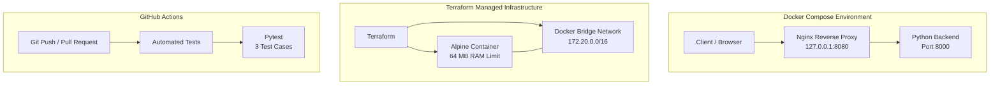

# Cloud Infrastructure Lab Architecture

## Architecture Diagram

## Components

### Docker Compose
- Nginx acts as a reverse proxy.
- Python Backend handles HTTP requests and returns JSON responses.
- Nginx exposes the application through `127.0.0.1:8080`.

### Terraform
- Creates a dedicated Docker bridge network.
- Deploys an Alpine Linux container.
- Configures container memory and swap limits.

### GitHub Actions
- Runs automatically on pushes to `main` and pull requests targeting `main`.
- Installs Python 3.12 and pytest.
- Executes automated backend tests.
